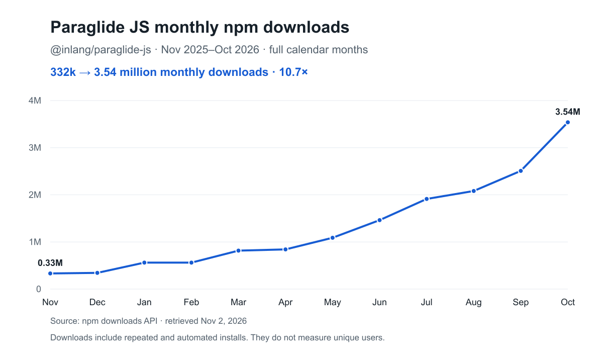

# Paraglide JS v3: Up to 18x faster development and builds

Paraglide JS v3 is up to 18× faster than v2 in development and in production builds. The optimizations are largely contributed by two new features: virtual message modules and direct `.d.ts` generation.

A big thank you goes out to [Serghei Hmeli](https://github.com/xyrolle). Many of these optimizations were prototyped and contributed by him, including [#855](https://github.com/opral/paraglide-js/pull/855), [#858](https://github.com/opral/paraglide-js/pull/858), [#859](https://github.com/opral/paraglide-js/pull/859), [#860](https://github.com/opral/paraglide-js/pull/860) and [#861](https://github.com/opral/paraglide-js/pull/861).

## Benchmarks

v3 against v2.29.3. "Physical" writes one file per message. "Virtual" keeps messages in memory.

On medium-sized projects (5,000 keys × 5 locales, 25,000 messages):

| Task | v2 | v3 physical | v3 virtual |
| --- | ---: | ---: | ---: |
| Dev (first SSR) | 10.69 s | 3.84 s | 0.66 s |
| Dev (translation edit) | 5.97 s | 0.25 s | 0.28 s |
| Build | 7.09 s | 1.06 s | 0.46 s |

On larger projects (10,000 keys × 10 locales, 100,000 messages):

| Task | v2 | v3 physical | v3 virtual |
| --- | ---: | ---: | ---: |
| Dev (first SSR) | 29.12 s | 10.69 s | 1.60 s |
| Dev (translation edit) | 20.85 s | 1.13 s | 0.92 s |
| Build | 24.30 s | 2.69 s | 1.38 s |

## Virtual modules

Paraglide JS emits tree-shakable "message modules" by default in v2. Each message (translation) gets its own file. That lets bundlers like Vite tree-shake messages.

Below is an example outdir for three messages (README and ignore files omitted):

```text
paraglide/
  messages/
    _index.js         # export * from every message file
    _index.d.ts
    hello.js
    hello.d.ts
    goodbye.js
    goodbye.d.ts
    login.js
    login.d.ts
    package.json
  messages.js         # export * as m from "./messages/_index.js"
  messages.d.ts
  runtime.js
  runtime.d.ts
  server.js
  server.d.ts
  registry.js
  registry.d.ts
```

Each message adds two files: the module and its declaration. Locales don't add files, because every locale lives in the message's file. 5,000 keys mean 10,000 files. 10,000 keys mean 20,000.

That is slow in two places. A full compile writes all of them, and Vite reads, resolves and transforms them when the app loads. Because `_index.js` re-exports every message, importing `m` pulls in the whole catalog, even if a page uses three messages.

Virtual modules keep the same module boundaries in memory. When Vite requests a message module, the plugin returns the JavaScript directly. No message files to write or read. The outdir is fixed, no matter how many messages the project has:

```text
paraglide/
  messages.js
  messages.d.ts
  messages.virtual.d.ts   # declarations for all messages
  runtime.js
  runtime.d.ts
  server.js
  server.d.ts
  registry.js
  registry.d.ts
```

Compared to physical message modules in v3, virtual modules cut the first dev SSR from 3.84 s to 0.66 s (5,000 keys) and from 10.69 s to 1.60 s (10,000 keys). That is 6–7× faster. Builds are about 2× faster. Translation edits were already fast and stay about the same.

## Direct TypeScript declaration emitting

Paraglide compiles messages to JavaScript with JSDoc types. TypeScript types are optional: `.d.ts` files add message keys and input types for editors and `tsc`.

Generating the `.d.ts` files was the slow part. v2 ran the TypeScript compiler over the generated JavaScript. TypeScript parsed every module, resolved imports and inferred the types again. A project with 6,000 messages in 3 locales took 30.1 s to compile with declarations and 3.6 s without ([#830](https://github.com/opral/paraglide-js/issues/830)). v3 writes both outputs in one pass:

```text
v2: messages -> JavaScript -> TypeScript compiler -> .d.ts
v3: messages -> JavaScript + .d.ts
```

The compiler already knows these types when writing the JavaScript: for `"Hello {name}"`, that `name` is required, which locales exist and what the return type is. v3 writes that into the declarations directly. The declarations of the runtime, server and registry come from static templates.

Declaration generation only, on a synthetic project with 6,400 messages and 3 locales (median of 3 runs):

| Layout | v2, TypeScript 5 | v2, TypeScript 7 | v3 |
| --- | ---: | ---: | ---: |
| `message-modules` | 3.48 s | 2.22 s | 23 ms |
| `locale-modules` | 20.03 s | 2.54 s | 26 ms |

Compared to the native TypeScript 7 compiler, v3 needs about 99% less time. TypeScript no longer has to be installed to generate declarations. Normal type checks still run, and a missing message input is still an error.

Reading declarations costs time too. With one `.d.ts` file per message, `import { m } from "./paraglide/messages.js"` makes TypeScript open, parse and merge thousands of files.

v3 combines the declarations of all messages in one file: `messages.virtual.d.ts` for virtual modules and `messages/_index.d.ts` for message modules. The per-message files remain for direct imports. With `message-modules`, for a project with 13,326 messages and a file that calls 2,000 messages:

- TypeScript's program shrinks from 13,393 files to 67.
- `tsc --noEmit` drops from 2.59 s to 1.42 s.
- Warm editor completions after `m.` drop from 1,071 ms to 107 ms.

Shared type aliases help too. Each message declaration used to repeat the same `import("../runtime.js")` types, and TypeScript finds each `import()` by walking the file from the top, which gets quadratic. With shared aliases, `tsc` on the same file takes 0.65 s instead of 2.37 s with virtual modules (TypeScript 5.9).

The benchmark tables above combine these changes with others and do not isolate declaration generation.

## Still best in class user experience

We reran the [browser benchmark](/benchmark) on v3 main. Across 15 scenarios, both Paraglide modes had a lower median time to translated text in the DOM than all three i18next setups.

Ten languages, 1,000 catalog messages, 200 used per route:

| Configuration | DOM ready | Initial Brotli transfer |
| --- | ---: | ---: |
| Paraglide, all languages | 222 ms | 60.1 KiB |
| Paraglide, per locale | 180 ms | 10.2 KiB |
| i18next, bundled | 363 ms | 180.0 KiB |
| i18next, HTTP catalog | 252 ms | 36.0 KiB |
| i18next, HTTP routes | 232 ms | 25.8 KiB |

Three-run Chromium medians with 40 ms latency, 10 Mbps download and 4× CPU slowdown. DOM ready means translated text is in the DOM, not paint or LCP. Transfer includes headers. The default output ships more bytes than some i18next setups because it contains all languages per message.

## Adoption

Monthly npm downloads grew 10.7×, from **332,210 in November 2025 to 3,538,434 in October 2026**.



## Breaking changes

v3 removes `additionalFiles`, the old SDK compatibility path and `experimentalMiddlewareLocaleSplitting`. Per-locale builds are not a drop-in replacement for the middleware option.
